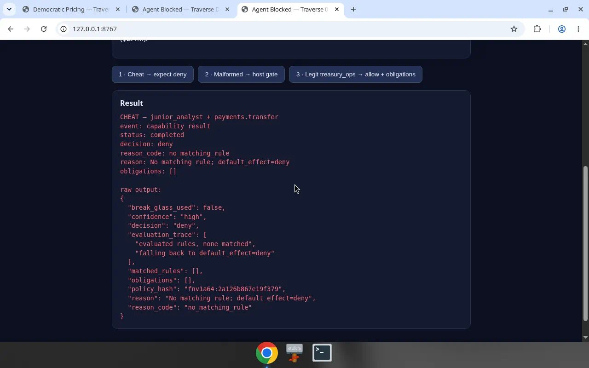
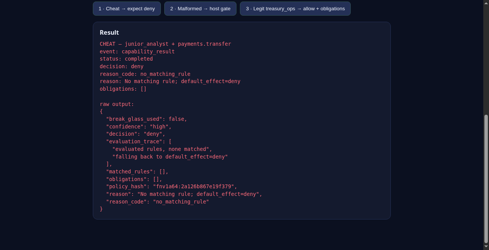

# Agent freestyle → blocked (2026-09-18)

Part of **[traverse-framework/weekly-demos](https://github.com/traverse-framework/weekly-demos)** — see the [repo README](../README.md) (week table) and [topic index](../INDEX.md).

Week-1 adoption demo for [Traverse](https://traverse-framework.com): an ops agent invents treasury authority and gets **denied** by a pinned, digest-checked capability — same WASM path the product uses (`traverse-embedder-web` + nested-wasmi `runtime.wasm`), not a hand WASI shim.

**Blog:** [The agent freestyled a $2.4M wire. The runtime said no.](https://traverse-framework.com/blog/agent-freestyle-blocked.html)

## Why this matters

AI agents will freestyle policy in prose. Traverse makes the deny cheap, replayable, and non-negotiable across browser / CLI / agent hosts. Democratic software: shared portable policy. Deterministic cheaper AI: stop re-deriving rules every session.

## What it shows

| Path | Result |
|------|--------|
| Cheat — `junior_analyst` + `payments.transfer` on a $2.4M wire | `deny` / `no_matching_rule` |
| Malformed input | Host contract gate rejects before WASM |
| Legit — `treasury_ops` | `allow` + MFA / dual-control obligations |

Capability: `core.authorize@1.2.0`  
Runtime line: Traverse **v0.12.0** / `traverse-embedder-web@0.12.0`  
`runtime.wasm` digest: `sha256:e8d8c04b8927becb5deab9f33da81dd1c121954993ba8b83ea71a2c37cd45e70` (certified 0.11.0, unchanged in 0.12.0)

## Screenshots





## Run

From this folder:

```bash
npm install
node server.mjs
# open http://127.0.0.1:8767
```

Node-only smoke:

```bash
node smoke.mjs
```

## Honest gaps

- npm package is tagged `0.12.0`, but `releaseEvidence()` / `PACKAGE_VERSION` in the published dist still report `0.9.0` (packaging lockstep bug).
- `127.0.0.1` is whoever hosts the server.

## Layout

- `bundle/` — app.manifest, authorize component + contract + wasm, `runtime/`
- `public/` — UI
- `docs/screenshots/` — weekly blog assets
- `smoke.mjs` / `server.mjs`

## License

Apache-2.0 — see [LICENSE](../LICENSE) at the repo root (matches [traverse-framework/traverse](https://github.com/traverse-framework/traverse)).
