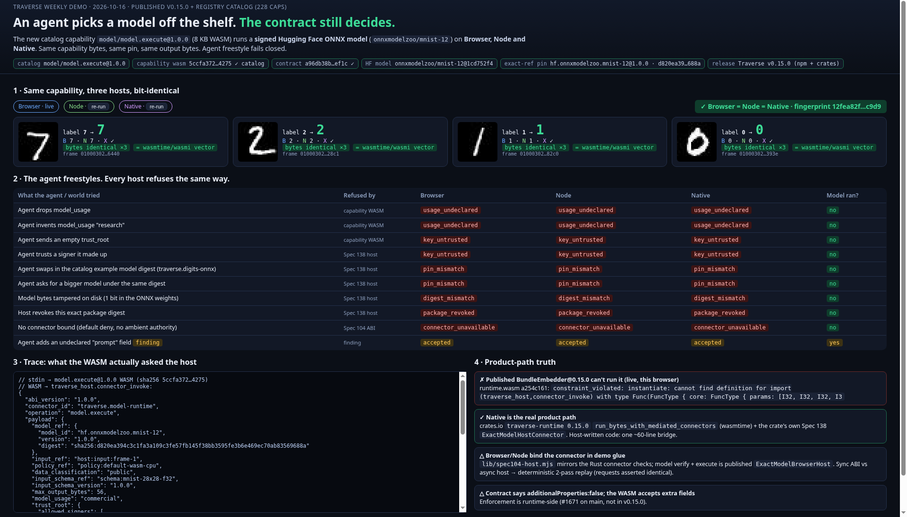

# 2026-10-16 · catalog-model-execute

**An agent picks a model off the shelf. The contract still decides.**

The registry's brand-new catalog capability [`model/model.execute@1.0.0`](https://registry.traverse-framework.com) (8,243-byte WASM, published 2026-10-15 via registry#639) runs a **signed Hugging Face ONNX model** ([`onnxmodelzoo/mnist-12`](https://huggingface.co/onnxmodelzoo/mnist-12) @ `1cd752f4`) on **three hosts: Browser, Node, Native**. The capability bytes, the exact-ref pin and the model output bytes are the same everywhere. Every agent freestyle fails closed with the same Spec 138 reason on every host.



## What's proven (`proof/digest-match.json` → `all_identical: true`)

- **Same capability bytes.** `model-execute-agent.wasm` sha256 `5ccfa372…4275` equals the catalog digest, and `contract.json` sha256 `a96db38b…ef1c` equals the catalog `contract_digest`. Both are checked on every host before anything runs.
- **Bit-identical across 3 hosts.** In all 14 scenarios (4 digits + 10 freestyle attempts), the capability's stdout JSON and the 56-byte model output frame are identical on Browser (Chrome 154), Node 22.12 and Native (wasmtime 44). The 4 digit frames also equal the `traverse-cli` 0.15.0 conformance vector that was checked on **wasmtime and wasmi**. Predictions 7, 2, 1, 0 are correct. Browser and Node fingerprint: `12fea82f…c9d9`.
- **Agent freestyle refused, identically:**

| Attempt | Refused by | Reason (B = N = X) |
| --- | --- | --- |
| drops `model_usage` | capability WASM (connector never called) | `usage_undeclared` |
| invents `model_usage: "research"` | capability WASM | `usage_undeclared` |
| empty `trust_root` | capability WASM | `key_untrusted` |
| trusts a made-up signer | Spec 138 host | `key_untrusted` |
| swaps in the catalog example digest (`traverse.digits-onnx`) | Spec 138 host | `pin_mismatch` |
| asks for a bigger model id under the same digest | Spec 138 host | `pin_mismatch` |
| 1 bit flipped in the ONNX weights | Spec 138 host | `digest_mismatch` |
| host revokes the digest | Spec 138 host | `package_revoked` |
| no connector bound | Spec 104 ABI (no ambient authority) | `connector_unavailable` |
| adds an undeclared `prompt` field | — | **accepted** (finding, see below) |

## Hosts, honestly

| Host | Path | Product path? |
| --- | --- | --- |
| **Native** | crates.io `traverse-runtime 0.15.0` `WasmExecutor::run_bytes_with_mediated_connectors` (wasmtime 44.0.3) + the same crate's Spec 138 `exact_model::ExactModelHostConnector` | **Yes**, except a 63-line host bridge (`native-host/src/main.rs`) from Spec 104 `MediatedConnector` to Spec 137 `HostConnectorPort`. No such bridge ships. |
| **Node** | npm `traverse-embedder-web@0.15.0` `ExactModelBrowserHost` (verify, rights, usage, status, execute) | **Partial.** Guest linking plus `connector_invoke` is demo glue (`lib/spec104-host.mjs`, 55 lines, mirrors the Rust checks). |
| **Browser** | Same code as Node, live in Chrome | **Partial**, same glue. |
| **Product path in Browser/Node** | `BundleEmbedder@0.15.0` + `runtime.wasm` a254c161 | **Fails**: `constraint_violated: instantiate: cannot find definition for import (traverse_host,connector_invoke)`. See `proof/bundle-embedder-probe.json` and `proof/browser-bundle-embedder-probe.json`. |

The sync/async mismatch is real: Spec 104 `connector_invoke` is synchronous, but `ExactModelBrowserHost.execute` is async. The JS glue therefore runs the pure guest twice. Pass 1 records the exact request, the host executes it, and pass 2 replays the guest with the response ready. The requests are asserted byte-identical.

## Findings (filed as tickets, see CEO-BRIEF)
1. Published `runtime.wasm` and `BundleEmbedder` cannot instantiate any guest that imports `traverse_host.connector_invoke`, and the JS embedder has no API to activate a mediated connector. So the catalog's `model.execute@1.0.0` runs on **no** published Browser, Node or Swift host. As of `main` b3c0796c, code search finds `connector_invoke` only in the native `wasmtime` executor.
2. No shipped `traverse.model-runtime` binding connects Spec 104 guest calls to Spec 138 `ExactModelHostConnector`. Every native host must hand-write that bridge, including the `&self` vs `&mut self` mutex.
3. Evidence shape: the catalog `output_example.model_evidence` is flat (`{license_id, commercial_use}`), but the hosts return `ModelRightsRecord` with nested `rights` and `source_url` fields. The Spec 104 host-private filter rejects any string containing `://`, so passing the host's real evidence through verbatim fails with `unauthorized_output`. Each bridge has to pick fields by hand.
4. The contract declares `additionalProperties: false`, but the WASM accepts extra fields. Enforcement is runtime-side (#1671, on `main` but not in v0.15.0).

## Run
```bash
npm install                       # traverse-embedder-web@0.15.0
npm run node                      # Node -> proof/node.json (+ scenarios)
cd native-host && cargo +1.94.0 build --release && cd ..
jq '.scenarios' proof/node.json > proof/scenarios.json
./native-host/target/release/model-execute-native-host $PWD proof/scenarios.json > proof/native-mediated.json
node hosts/native-run.mjs         # traverse-cli 0.15.0 model verify + conformance (wasmtime+wasmi)
PORT=8776 node server.mjs         # Browser live at http://127.0.0.1:8776 -> proof/browser.json
node hosts/digest-match.mjs       # 3-host comparison
```

## Pins
Traverse v0.15.0 (tag @ `44915539`); npm `traverse-embedder-web@0.15.0`; crates.io `traverse-runtime`/`traverse-contracts` `0.15.0`; `traverse-cli-rs 0.15.0`; `runtime.wasm` `a254c161`; catalog `model/model.execute@1.0.0` WASM `5ccfa372…4275`, contract `a96db38b…ef1c`; model `hf.onnxmodelzoo.mnist-12@1.0.0` manifest pin `d820ea39…688a`, `model.wasm` `fd0735e4…f973`; signer `ed25519:986edbcb…a8ce` (**throwaway prototype key, public half only in this tree; no production trust**).
