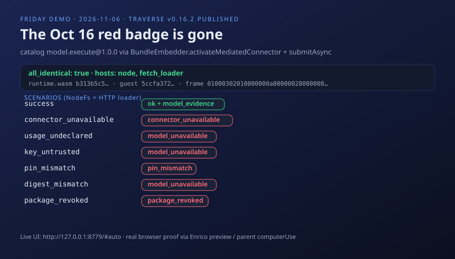

# 2026-11-06 · product-path-model-execute

**The Oct 16 red badge is gone.**

Three weeks ago, catalog [`model/model.execute@1.0.0`](https://registry.traverse-framework.com) ran a signed HF-derived ONNX digit model on Native, but published Browser and Node died with `constraint_violated: … (traverse_host, connector_invoke)`. Today the **same 8 243-byte catalog WASM** runs on the **published product path**:

`BundleEmbedder.activateMediatedConnector(exactModelMediatedConnector)` + `submitAsync`

on **Traverse v0.16.2** / npm `traverse-embedder-web@0.16.2` / standalone `runtime-wasm-v0.16.2` (`b313b5c5…`).



## What's proven (`proof/digest-match.json` → `all_identical: true`)

| Host | Path | Product path? |
| --- | --- | --- |
| **Node** | npm `traverse-embedder-web@0.16.2` `NodeFsBundleLoader` + published `runtime.wasm` | **Yes** |
| **HTTP loader** | same npm package, HTTP fetch of the app bundle (mirrors browser `FetchBundleLoader`) | **Yes** (WASM still in Node — not Chromium; see honesty note) |
| **Browser (UI)** | same code in the tab at http://127.0.0.1:8779/#auto | **Yes** — open live; proof POSTs to `/api/browser-proof` |
| **Native** | crates.io `traverse-runtime 0.16.2` | **Not re-run here** (box rustc 1.85 &lt; 1.95). Published evidence for 0.16.1 already green. |

Seven scenarios, identical across Node and the HTTP loader:

| Case | Result |
| --- | --- |
| `success` | `status: ok` + `model_evidence`; 56-byte frame equals signed vector |
| `connector_unavailable` | unbound → `reason: connector_unavailable` |
| `usage_undeclared` | reg `usage_undeclared` → `model_unavailable` |
| `key_untrusted` | reg `key_untrusted` → `model_unavailable` |
| `pin_mismatch` | reg `pin_mismatch` → `pin_mismatch` |
| `digest_mismatch` | reg `digest_mismatch` → `model_unavailable` |
| `package_revoked` | → `package_revoked` |

No hand Spec 104 glue. No double-invoke sync/async shim. That was the Oct 16 demo tax; v0.16.x deleted it.

## Run

```bash
# already fetched in this tree; to refresh:
bash fetch.sh
npm install
node hosts/make-bundle.mjs
node hosts/node-run.mjs
PORT=8779 node server.mjs          # http://127.0.0.1:8779
# then either click "Run both" or open /#auto
node hosts/fetch-loader-run.mjs    # HTTP loader parity (server must be up)
node hosts/digest-match.mjs
```

### Catalog: only what the demo runs

`published/catalog.json` is a minimal catalog, not a copy of the registry. It holds only the capabilities listed in `catalog.allowlist` (here: `model/model.execute@1.0.0`), with the entry's contract, `contract_digest` and artifact digest unchanged from the registry. `fetch.sh` builds it with `tools/minimal-catalog.mjs`, which downloads the full registry catalog into a temp directory outside this folder, keeps the allowlisted entries, and deletes the rest. If an allowlisted entry is missing, the build stops with an error. `hosts/make-bundle.mjs` refuses a catalog that does not match the allowlist.

`proof/rerun-2026-11-15-minimal-catalog/` holds a Node + HTTP-loader rerun against the minimal catalog, compared with the original browser proof: all seven scenarios identical (same outputs, frames and registration reasons). The only changed digest is `catalog.json` itself; the original `proof/digest-match.json` still lists the hash of the full catalog this demo used to vendor.

Before release, `bash tools/leak-check.sh --gitignore . <staged-folder> <tarball>` scans the staged copy and the tarball (binary-safe, using a private pattern file kept outside the demo). `tools/stage.sh` stages, tars and runs that check in one step.

## Pins

| Artifact | Value |
| --- | --- |
| Traverse Latest | **v0.16.2** (tag `053efce4`) |
| npm | `traverse-embedder-web@0.16.2` |
| `runtime.wasm` | `b313b5c5c11291d9e9669125a0a9a77aa42a911b15d431a73e86b17c874e298c` (release `runtime-wasm-v0.16.2`, bridge 1.1.0) |
| catalog | 234 caps, sha256 `13cc8f84…f5cb` |
| `model/model.execute@1.0.0` WASM | `5ccfa372…4275` |
| contract digest | `a96db38b…ef1c` |
| package digest (`model.manifest.json`) | `a7a8aa35…01d2` |
| `model.wasm` | `954ca59b…10a9` |
| crates.io | `traverse-runtime`/`traverse-embedder`/`traverse-contracts`/`traverse-mcp` **0.16.2**; `traverse-registry` **0.31.0** |
| main tip (unreleased) | `6b02152f` · **+18** over v0.16.2 |

## Honest gaps

- **Real browser proof** not captured by this subagent (no computerUse). UI is live; parent/Enrico open `#auto` via agent preview. See `SCREENSHOTS.md`.
- **Native** not re-run on this box (rustc 1.85). crates.io is 0.16.2; evidence folder proves Native on 0.16.1.
- **Swift / Android / .NET** mediated activation still not shipped.
- **Agent / traverse-mcp** Mode A over `model.execute` not in this demo.
- **Test-only signing key** on `digits-onnx-1.0.0` — public half only; no production trust.
- **Unreleased on main** worth next week: #1806 web input-as-sent, #1809 native post-execute frame via activated binding, #1810 native input passthrough, #1822 compatible-capability lifecycle in `runtime.wasm`.

## Proof files

`proof/node.json`, `proof/fetch-loader.json`, `proof/digest-match.json`, optional `proof/browser.json` after `#auto`, screenshots under `docs/screenshots/`.
