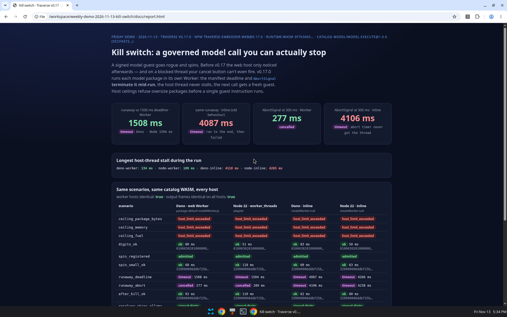

# 2026-11-13 · kill-switch

**A governed model call you can actually stop.**

A signed model guest goes rogue and spins. Before Traverse v0.17, the web host only *noticed* afterwards: the deadline and the cancel signal were checked before and after the guest ran, and the thread froze in between. On the page thread, your cancel button couldn't even fire.

**v0.17.0** (npm `traverse-embedder-web@0.17.0`, `runtime.wasm` `3f763665…`) runs every model package in its own Worker. The manifest deadline and `AbortSignal` **terminate the guest mid-run**, the UI never stalls, and the next call gets a fresh guest. Host ceilings (`maxPackageBytes` / `maxMemoryBytes` / `maxFuel`) refuse an oversize package **before a single guest instruction runs**.

Same catalog `model/model.execute@1.0.0` WASM (`5ccfa372…`) on the published product path (`BundleEmbedder.activateMediatedConnector(exactModelMediatedConnector)` + `submitAsync`). Same outcomes on **Deno** (V8, the package’s unmodified default web-Worker path — the browser path) and **Node 22** (`worker_threads`). The Chromium leg could not run this week (see Gaps).



## The numbers (from `proof/*.json`)

| Scenario | deno-worker | node-worker | deno-inline | node-inline |
| --- | --- | --- | --- | --- |
| `ceiling_package_bytes` | `host_limit_exceeded` | `host_limit_exceeded` | `host_limit_exceeded` | `host_limit_exceeded` |
| `ceiling_memory` | `host_limit_exceeded` | `host_limit_exceeded` | `host_limit_exceeded` | `host_limit_exceeded` |
| `ceiling_fuel` | `host_limit_exceeded` | `host_limit_exceeded` | `host_limit_exceeded` | `host_limit_exceeded` |
| `digits_ok` | `ok` 80 ms | `ok` 51 ms | `ok` 83 ms | `ok` 50 ms |
| `spin_registered` | `admitted` | `admitted` | `admitted` | `admitted` |
| `spin_small_ok` | `ok` 68 ms | `ok` 118 ms | `ok` 60 ms | `ok` 63 ms |
| `runaway_deadline` | `timeout` 1508 ms | `timeout` 1504 ms | `timeout` 4087 ms | `timeout` 4266 ms |
| `runaway_abort` | `cancelled` 277 ms | `cancelled` 289 ms | `timeout` 4106 ms | `timeout` 4238 ms |
| `after_kill_ok` | `ok` 92 ms | `ok` 110 ms | `ok` 62 ms | `ok` 80 ms |
| `resolver_skips_ollama` | `signed-digits` | `signed-digits` | `signed-digits` | `signed-digits` |

Longest host-thread stall: deno-worker **134 ms** · node-worker **180 ms** · deno-inline **4110 ms** · node-inline **4265 ms**

`worker_hosts_identical: true` · `frames_identical_all_hosts: true` (`proof/compare.json`)

## What runs

| Piece | What it is |
| --- | --- |
| `model/model.execute@1.0.0` | Catalog capability WASM, unchanged since Nov 6 (`sha256:5ccfa372…4275`) |
| `traverse.digits-onnx@1.0.0` | Real signed HF-derived ONNX digits package (Traverse test key); output frame equals the signed conformance vector on every host |
| `demo.runaway-spin@1.0.0` | 185-byte ABI v1 demo guest: frame = u32 work units, each = 1M LCG steps; deterministic 8-byte output. Manifest `max_execution_ms: 1500`. **Signed with a demo-only Ed25519 key generated on the box**, trusted by this host only |
| Deno 2.9.8 | Package default `modelWorker.js` module Worker, unmodified; bundle fetched over HTTP with `FetchBundleLoader` (`hosts/deno-kill.mjs`) |
| Browser | Same code wired into `public/` (`/#auto`); **not run this week** (box browser loopback firewall) |
| Node 22 | `worker_threads` via the small adapter the package typings call for (`hosts/node-worker.mjs`) |
| "inline" | `createWorker: null` — the pre-0.17 behaviour, kept as an option |

## Scenarios

| Scenario | Expected |
| --- | --- |
| `ceiling_package_bytes` / `ceiling_memory` / `ceiling_fuel` | `host_limit_exceeded` at registration |
| `digits_ok` | `ok`, frame == signed vector |
| `spin_small_ok` | `ok`, frame `320000006ddbf25b` |
| `runaway_deadline` | Worker: `timeout` at ~1.5 s. Inline: guest runs to the end (~4 s), *then* `timeout` |
| `runaway_abort` | Worker: `cancelled` at ~300 ms. Inline: abort timer can't fire on a blocked thread → still `timeout` after ~4 s |
| `after_kill_ok` | `ok` — fresh guest after the kill |
| `resolver_skips_ollama` | Spec 045 browser resolver: `ollama.local.generate` rejected without an HTTP probe, signed exact-ref pin selected, `trust_class: verified_signed_package` |

## Run

```bash
bash fetch.sh                       # or use the vendored tree
node hosts/node-kill.mjs worker     # Node, Worker (worker_threads)
node hosts/node-kill.mjs inline     # Node, createWorker:null
PORT=8780 node server.mjs &         # serves bundle + fixtures (+ browser UI)
deno run -A --node-modules-dir=manual --location http://127.0.0.1:8780/ hosts/deno-kill.mjs worker   # and: inline
# browser: http://127.0.0.1:8780/#auto runs worker + inline in the tab
node hosts/report.mjs               # docs/report.html (static, self-contained)
node hosts/compare.mjs              # proof/compare.json
```

### Catalog: only what the demo runs

`published/catalog.json` is a minimal catalog, not a copy of the registry. It holds only the capabilities listed in `catalog.allowlist` (here: `model/model.execute@1.0.0`), with the entry's contract, `contract_digest` and artifact digest unchanged from the registry. `fetch.sh` builds it with `tools/minimal-catalog.mjs`, which downloads the full registry catalog into a temp directory outside this folder, keeps the allowlisted entries, and deletes the rest. If an allowlisted entry is missing, the build stops with an error. `hosts/make-bundle.mjs` refuses a catalog that does not match the allowlist.

Before release, `bash tools/leak-check.sh --gitignore . <staged-folder> <tarball>` scans the staged copy and the tarball (binary-safe, using a private pattern file kept outside the demo) and checks that the demo signing key is gitignored and absent. `tools/stage.sh` stages, tars and runs that check in one step. `proof/rerun-2026-11-15-minimal-catalog/` holds a Node + Deno rerun against the minimal catalog: same reasons, frames and signed-vector match as `proof/`.

## Runtime truth (2026-11-13)

- **npm `traverse-embedder-web@0.17.0`** published (latest). Also published: `traverse-mcp-v0.17.0` binaries (verified checksum, `traverse-mcp 0.17.0 (78aecd66)`), `swift-host-v0.17.0`, `onnx-runner-v0.17.0`.
- **v0.17.0 never became a product release**: its crates.io publish failed (`#1849`), so no `v0.17.0` GitHub Release and no `runtime-wasm-v0.17.0` asset. This demo pins `runtime.wasm` from the `v0.17.0` tag tree (`runtime/runtime.wasm`, `3f763665…`, runtime 0.17.0, bridge 1.1.0).
- **v0.17.1** is tagged on main today (`2fdce4a8`) as the first full product release of 0.17; crates.io still shows 0.16.2 at time of writing.
- Breaking in 0.17: one compatible lifecycle in `runtime.wasm` on every host; Rust embedder takes raw JSON text; guests get only the submitted input.
- Catalog: 259 capabilities (was 234 on Nov 6); new `model/model.execute@1.1.0` alongside 1.0.0.

## Gaps (honest)

- **Chromium leg not run.** The box browser now firewalls loopback (only the egress proxy port is allowed), so the live page at `http://127.0.0.1:8780/#auto` is refused in the box browser. Deno exercises the identical default-Worker code path; the browser UI ships in `public/` for anyone to run locally. Screenshots are of the static `docs/report.html` rendered from the proof JSON.

- **Native wasmtime epoch interruption** (also new in 0.17) was **not** re-run: no 0.17 crates on crates.io yet, and the box's rustc 1.85 is below the workspace MSRV.
- The runaway guest is a demo guest, not a real model, signed with a box-local key. That's the point of host trust: the host decides which keys count.
- Node needs a hand adapter for `worker_threads` (the typings say so). A shipped `nodeModelWorker()` helper would remove that.
- Browser cannot meter fuel; `maxFuel` is enforced at registration only (documented).
- The Worker path pays a guest spawn + compile on the first call and after every kill (~50–100 ms here).
